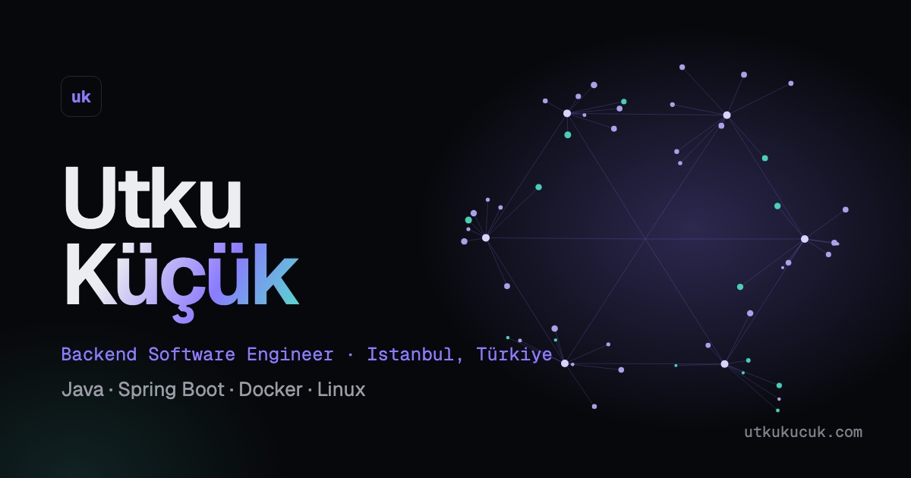

# utkukucuk.com

[](https://github.com/utku-kucuk/utkukucuk.com/actions/workflows/ci.yml)

Source code for the personal portfolio of **Muhammet Utku Küçük**, Backend Software Engineer — live at **[utkukucuk.com](https://utkukucuk.com)**.



## Highlights

- **Interactive WebGL hero** — a live "service graph" where request packets travel between services, rendered with a ~3 kB raw WebGL renderer (no 3D library)
- **Motion** — GSAP ScrollTrigger + SplitText, Lenis smooth scrolling, pinned horizontal project scroll, magnetic buttons and a custom cursor; everything turns off under `prefers-reduced-motion`
- **Bilingual** — English at `/`, Turkish at `/tr/`, with `hreflang` and an i18n sitemap
- **Case studies** written in MDX with animated, data-driven architecture diagrams
- **Fast & hardened** — static output, hashed Content-Security-Policy, security headers, Lighthouse 94–100 on mobile

## Tech stack

| Area      | Choice                                                     |
| --------- | ---------------------------------------------------------- |
| Framework | [Astro](https://astro.build) (static output)               |
| Language  | TypeScript (strict)                                        |
| Styling   | Tailwind CSS v4 with CSS-variable design tokens            |
| Motion    | GSAP (ScrollTrigger, SplitText), Lenis, raw WebGL          |
| Content   | MDX content collections                                    |
| Quality   | ESLint, Prettier, `astro check`, Lighthouse CI, Dependabot |
| Hosting   | Cloudflare Pages                                           |

## Project structure

```
src/
├── components/   layout, sections, projects, ui
├── content/      projects/{en,tr}/*.mdx — case studies
├── data/         site config, experience, stack, diagrams
├── i18n/         UI dictionary and locale helpers
├── layouts/      BaseLayout (meta, theme, motion bootstrap)
├── pages/        routes (EN at /, TR at /tr/)
└── scripts/      hero WebGL scene, motion system
public/           CV PDFs, OG images, _headers, _redirects
```

## Getting started

Requires Node.js 22.12+ (see `.nvmrc`) and pnpm (via Corepack).

```bash
corepack enable
pnpm install
cp .env.example .env   # optional: contact form key
pnpm dev               # http://localhost:4321
```

## Scripts

| Command         | Description                                         |
| --------------- | --------------------------------------------------- |
| `pnpm dev`      | Start the dev server                                |
| `pnpm build`    | Build the static site into `dist/`                  |
| `pnpm preview`  | Preview the production build locally                |
| `pnpm lint`     | Lint with ESLint                                    |
| `pnpm format`   | Format with Prettier                                |
| `pnpm check`    | Type-check `.astro` and `.ts` files                 |
| `pnpm validate` | Run everything CI runs (lint, format, types, build) |

## Editing content

| What                    | Where                                   |
| ----------------------- | --------------------------------------- |
| Email, socials, CV path | `src/data/site.ts`                      |
| Experience              | `src/data/experience.ts`                |
| Skills / stack          | `src/data/stack.ts`                     |
| Project case studies    | `src/content/projects/{en,tr}/*.mdx`    |
| Architecture diagrams   | `src/data/diagrams.ts`                  |
| UI copy (EN/TR)         | `src/i18n/ui.ts`                        |
| CV PDFs                 | `public/cv/` (keep the same file names) |

## Deployment

Cloudflare Pages builds every push: `main` → production, pull requests → preview URLs.

| Setting          | Value                                                |
| ---------------- | ---------------------------------------------------- |
| Build command    | `pnpm build`                                         |
| Output directory | `dist`                                               |
| Environment      | `NODE_VERSION=24`, `PUBLIC_WEB3FORMS_KEY` (optional) |

## Contributing

See [CONTRIBUTING.md](./CONTRIBUTING.md) — branches, Conventional Commits and the squash-merge workflow.

## License

Source code is released under the [MIT License](./LICENSE). Written content, CV documents and photographs are © Muhammet Utku Küçük, all rights reserved.
